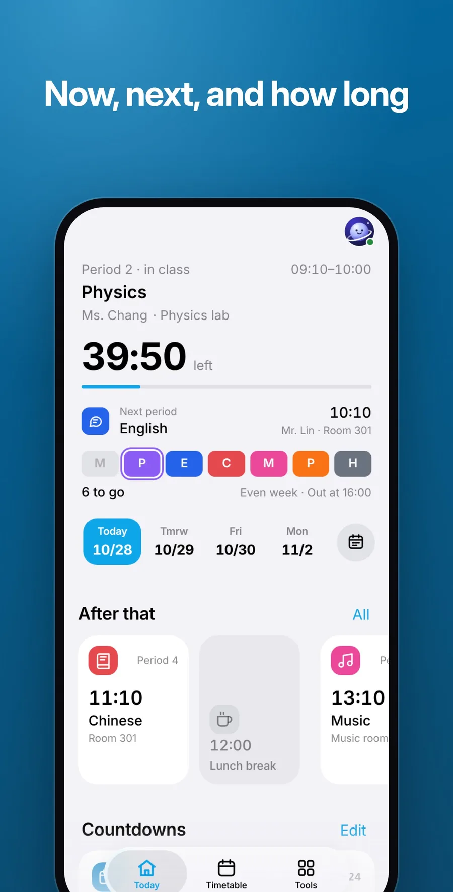
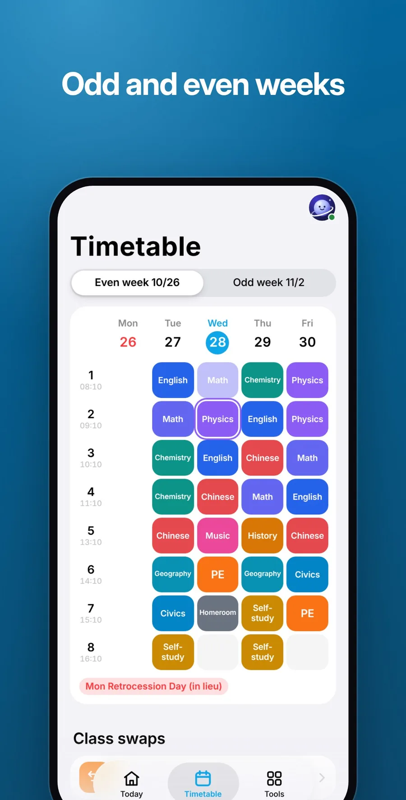
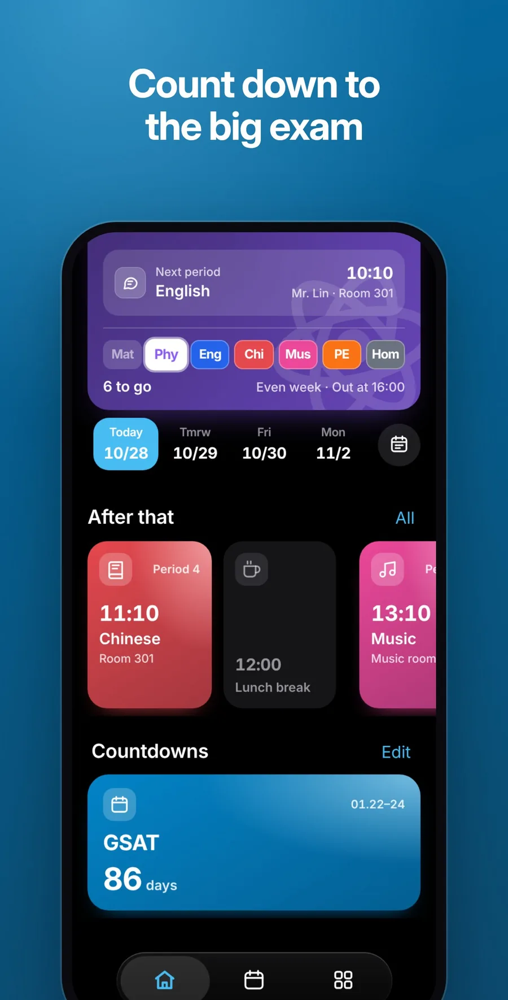
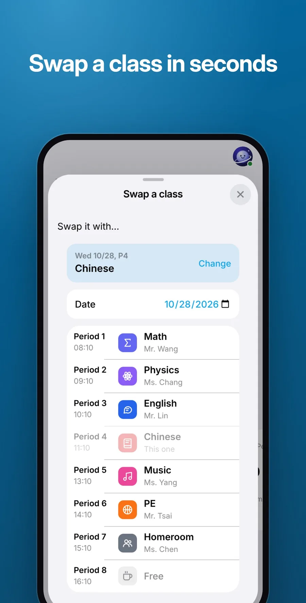
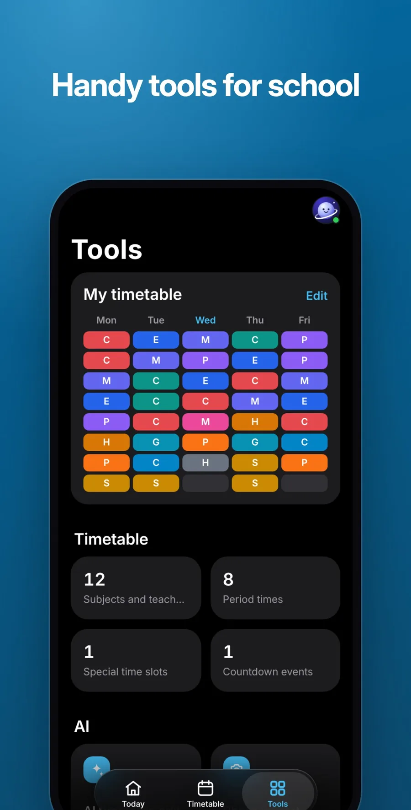

<p align="center">
  
</p>

<h1 align="center">Orbit Class</h1>

<p align="center">
  <b>Today's classes at a glance.</b><br>
  <a href="https://orbit.jaypengx.com/class/"><b>orbit.jaypengx.com/class</b></a>
</p>

<p align="center">
       
</p>

The class now and what comes next, at a glance. Part of **Orbit**, a family of phone apps for life in Taiwan that share one sign-in, the Orbit Pass. See them all at [orbit.jaypengx.com](https://orbit.jaypengx.com/pass/).

<p align="center">
  
  
  
</p>

<p align="center">
  
  
  
</p>

## Features

- **Today:** one card answers "what's left today": the class now with teacher, room and time left, the next one, and the day as a strip of coloured chips. After the last class it shows the next school day.
- **The week** as a grid, this week or the next, with odd and even weeks (單週 / 雙週) and subjects that alternate by week.
- **調課:** swap two periods on any two dates, even across weeks, and undo it.
- **Countdowns** to exams and events, removed by themselves once over if you like.
- **A notice five minutes before each class**, sent by the server so it arrives with the app closed; none on Taiwan's holidays.
- **AI photo import:** up to six photos, screenshots, HEIC or PDF read together as one timetable, checked locally and applied only once you confirm.
- **AI edit:** describe a change in a sentence and confirm it as a diff.
- **Share key:** an 8-character key gives a classmate their own copy for 24 hours.

## Tech stack

| Layer | What |
| --- | --- |
| App | Plain JavaScript (ES modules), HTML and CSS, bundled by Vite; no framework |
| Platform | Installable web app with a service worker; opens offline on the kept timetable |
| Shared | Look, Orbit Pass (which keeps the timetable) and notices from the kit in [Orbit-Core](https://github.com/JayPengX/Orbit-Core) |
| AI | Gemini through the Orbit proxy (`/gemini`, `/nl-edit`); the prompts and schemas live in the Worker, so the endpoint can't be used as a general AI |
| Tests | Vitest with jsdom, ESLint |

## How it works

- **Every second the state is recomputed from the clock** (weekday, odd or even week, the period or break now, the next one), and only the fields that changed are written to the page.
- **One rule for "which classes on this date"** (`classesOnDate` in `src/schedule.js`) feeds every view and every notice, swaps and holidays included.
- **Never lose an edit:** a device uploads only while the Pass still holds the copy it last saw; otherwise its edit is set aside, never overwritten.

Details and the decisions still in force: **[MAP.md](MAP.md)**.

## Project structure

```
index.html, css/        the page and its styles
src/
├── main.js, bootstrap.js         start-up
├── data.js                       read, write, validate, normalise
├── schedule.js, schedule-calc.js the running schedule; what to show now
├── dashboard.js                  the per-second loop
├── view-today.js, view-week.js, view-sheet.js, view-editor.js
├── editor-*.js                   the editor, backups, AI editing
├── gemini-ocr.js                 photo import
├── swap.js, tools.js, sync.js    調課, the tools tab, the Pass
└── state.js, constants.js, strings.js, dates.js
public/                 icons, manifest, service worker
test/                   Vitest
MAP.md                  how it works
```

## Getting started

The app loads the shared kit from a sibling folder, so clone this repo next to [Orbit-Core](https://github.com/JayPengX/Orbit-Core):

```bash
git clone https://github.com/JayPengX/Orbit-Core.git
git clone https://github.com/JayPengX/Orbit-Class.git
cd Orbit-Class
npm install
```

| Command | What |
| --- | --- |
| `npm run dev` | Serve it locally with Vite |
| `npm test` | Vitest (links `../Orbit-Core/kit` as `.kit` first) |
| `npm run lint` | ESLint |
| `npm run build` | Build `dist/` |
| `npm run preview` | Serve the built `dist/` |

See it on a phone-sized screen, signed in with a made-up wallet (after `npm run build`; needs Playwright):

```bash
node ../Orbit-Core/tools/preview.mjs orbit --live --width 375
```

The time simulation panel (in the transfer sheet, under Advanced) sets any day and time by hand.

## Deploying

Push to `main`. GitHub Actions runs the tests, builds with Vite and publishes `dist/` to GitHub Pages; the site Worker serves it at its orbit.jaypengx.com address. There are no pull requests or release branches.

## Part of Orbit

| App | What it is |
| --- | --- |
| [Orbit Sports](https://github.com/JayPengX/Orbit-Sports) | Every game you can watch in Taiwan, live |
| [Orbit Transit](https://github.com/JayPengX/Orbit-Transit) | Bus, train, metro and YouBike, planned and navigated |
| [Orbit Weather](https://github.com/JayPengX/Orbit-Weather) | One clear forecast, to the township |
| [Orbit Words](https://github.com/JayPengX/Orbit-Words) | English vocabulary that stays |
| [Orbit Securities](https://github.com/JayPengX/Orbit-Securities) | A Taiwan broker on play money |
| [Orbit Class](https://github.com/JayPengX/Orbit-Class) | Today's classes at a glance |
| [Orbit Beats](https://github.com/JayPengX/Orbit-Beats) | Endless music and your own beats |
| [Orbit Law](https://github.com/JayPengX/Orbit-Law) | Laws, rulings and bills, linked |
| [Orbit Money](https://github.com/JayPengX/Orbit-Money) | Your own books |
| [Orbit-Core](https://github.com/JayPengX/Orbit-Core) | The kit, the Orbit Pass and the Workers behind them all |

How it was all built, in pictures and numbers: [jaypengx.com/showcase](https://jaypengx.com/showcase/).
